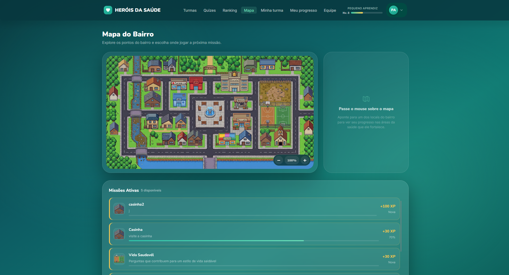
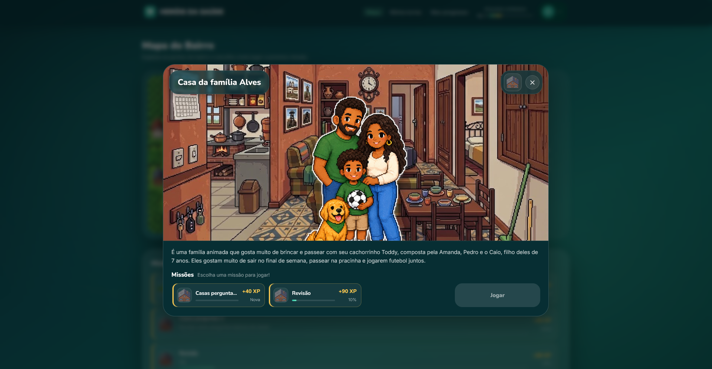
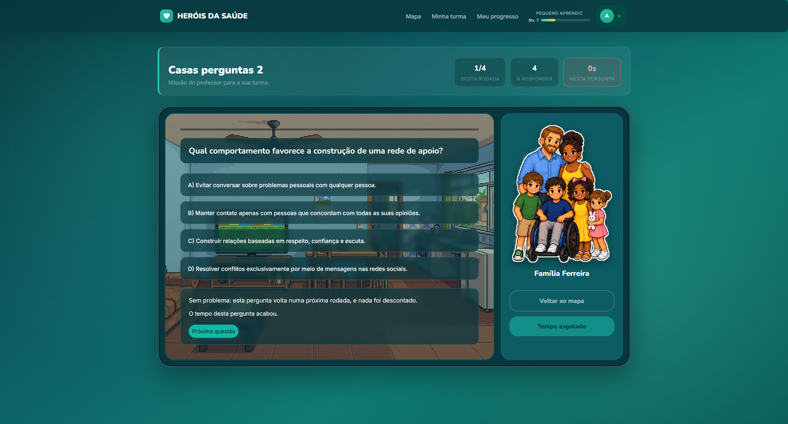
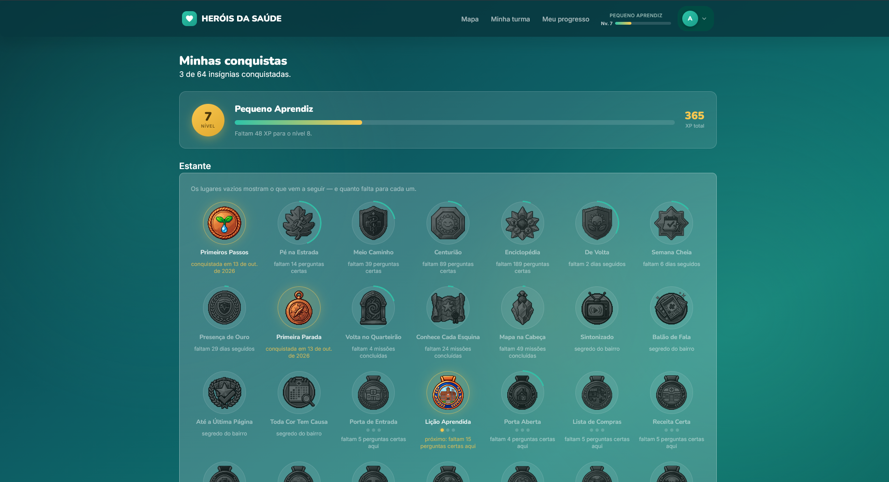
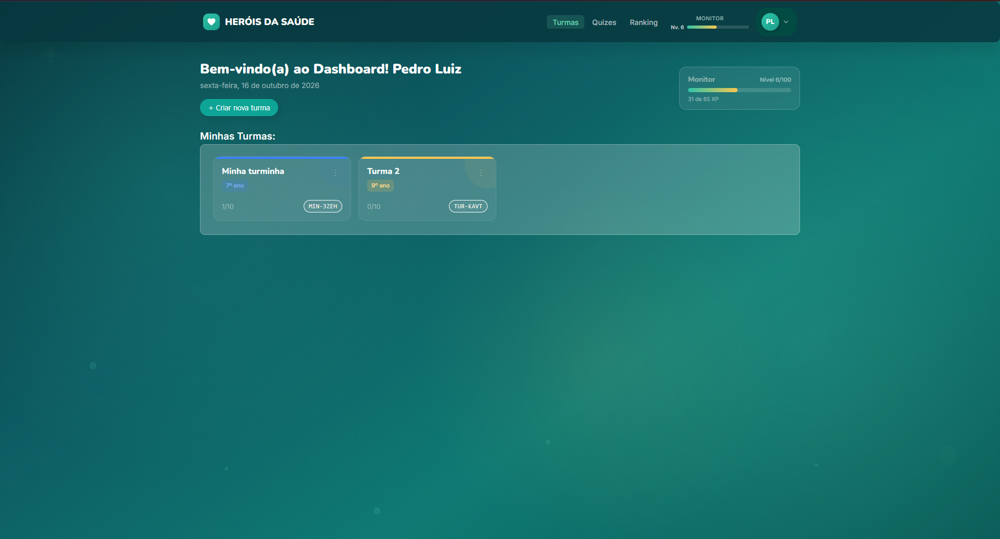
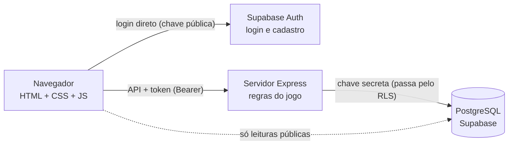

#  Heróis da Saúde

**Um bairro inteiro para cuidar.** Heróis da Saúde é um jogo educativo para crianças e adolescentes de 7 a 18 anos: o aluno explora um bairro em pixel art, entra na UBS, na farmácia, na escola e na casa de vinte famílias diferentes, e em cada lugar responde missões sobre saúde, prevenção e cuidado — enquanto o professor acompanha a turma de perto.

> **Projeto Interdisciplinar II** — Ciência da Computação (PUC Minas) & Medicina (PUC Betim)  
> O conteúdo pedagógico é escrito pela equipe de Medicina; o jogo, pela equipe de Computação.


<p align="center">
  
</p>

---

## Sumário

1. [O jogo em imagens](#-o-jogo-em-imagens)
2. [O que dá para fazer](#-o-que-dá-para-fazer)
3. [O conteúdo, em números](#-o-conteúdo-em-números)
4. [Como o sistema funciona](#-como-o-sistema-funciona)
5. [Tecnologias](#-tecnologias)
6. [Estrutura do projeto](#-estrutura-do-projeto)
7. [Rodando localmente](#-rodando-localmente)
8. [Banco de dados](#-banco-de-dados)
9. [Deploy na Vercel](#-deploy-na-vercel)
10. [Documentação](#-documentação)

---

##  O jogo em imagens

### Cada casa, uma família
Ao clicar num lugar do mapa, o aluno entra nele: a foto do interior, quem mora ali e as missões disponíveis. As vinte casas do bairro têm famílias diferentes — com suas histórias, rotinas e jeitos de cuidar da saúde.

<p align="center">
  
</p>

### Missões com o lugar de fundo
As perguntas aparecem sobre o interior do lugar visitado. Errar não é castigo: o jogo devolve uma explicação que dá a pista sem entregar a resposta, e a pergunta volta numa próxima rodada. O professor pode dar um tempo por pergunta — quando ele acaba, nada é descontado.

<p align="center">
  
</p>

### Conquistas, níveis e patentes
Cada acerto vale XP, e o XP sobe de nível (são 100). A estante mostra todas as 64 insígnias desde o começo — as bloqueadas em silhueta, com o quanto falta para cada uma. Algumas são **segredos**: estão escondidas dentro dos lugares do bairro, e o jogo só dá dicas de onde procurar.

<p align="center">
  
</p>

### O painel do professor
O professor cria as turmas, entrega um código curto para a sala entrar e monta os quizzes — sorteados pelo jogo ou escolhidos pergunta por pergunta. Ele também tem nível: o XP dele vem do avanço da turma.

<p align="center">
  
</p>

---

## O que dá para fazer

### Aluno
- **Explorar o bairro:** 16 lugares e 20 casas no mapa, com zoom, arraste e o progresso de cada lugar ao passar o mouse.
- **Jogar missões** passadas pelo professor, com a foto do lugar de fundo e explicação depois de cada resposta.
- **Acompanhar o próprio progresso** em 8 áreas da saúde — Saúde, Educação, Vacinação, Vetores, Limpeza, Alimentação, Exercícios e Felicidade —, sempre com rótulos gentis, nunca com nota vermelha.
- **Subir de nível e ganhar insígnias**, com o aviso "Conquista desbloqueada!" na hora do acerto.
- **Descobrir os segredos do bairro:** os quadrinhos educativos e os vídeos da Fiocruz na banca de jornal, o Calendário das Cores da Saúde na farmácia.
- **Ver a turma:** os colegas, a posição no ranking por XP e o professor, também com o nível dele.

### Professor
- **Criar turmas** com cor, ano escolar e um código de entrada (ex.: `MIN-3ZEH`).
- **Montar quizzes** em dois modos: *automático* (o jogo sorteia entre os cenários e áreas escolhidos, na faixa etária da turma) ou *manual* (o professor marca as perguntas uma a uma).
- **Escrever as próprias perguntas**, que só ele vê, ao lado das do sistema.
- **Acompanhar cada turma** e o **ranking das turmas**, ordenado por uma média que não deixa três respostas certas passarem na frente de quatrocentas.

### Equipe (admin)
- Painel para procurar pessoas, ajustar nível e XP (sempre com registro de quem fez e por quê), suspender contas, disparar recuperação de senha e renomear as patentes.

### Para todos
- **Referências:** a bibliografia do conteúdo, com busca, aberta a qualquer pessoa — mesmo sem conta.
- **Recuperação de senha** por um código de 5 caracteres enviado por e-mail.

---

## O conteúdo, em números

| | |
|---|---|
| **571** perguntas da equipe de Medicina | 154 para 7–10 anos · 278 para 11–14 · 139 para 15–18 (formato ENEM) |
| **8** áreas da saúde | cada pergunta pontua em uma ou mais |
| **16** lugares e **20** famílias no mapa | cada família com desenho, casa e descrição próprios |
| **64** insígnias | acertos, dias seguidos, missões por lugar e 4 segredos |
| **100** níveis | em 10 patentes, de *Pequeno Aprendiz* a *Herdeiro do Saber* |
| **12** HQs educativas | lidas dentro da banca de jornal |

O conteúdo é sempre escrito pela equipe de Medicina — nenhuma pergunta é inventada pelo código.

---

## Como o sistema funciona

O navegador conversa com **dois lugares diferentes, de propósito**, e essa divisão é a principal regra de segurança do projeto:



- **O login vai direto ao Supabase.** O servidor nunca vê uma senha; ele recebe um token e pergunta ao Supabase se ele vale.
- **Toda regra de jogo passa pelo servidor.** É lá que a resposta é corrigida, os pontos são somados e as insígnias são dadas. O gabarito nunca chega ao navegador — nem depois de errar.
- **O banco tem a sua própria tranca.** Mesmo com o servidor no meio, cada tabela tem políticas de RLS e permissões por coluna: o navegador não lê o gabarito, não troca a própria turma e não se dá pontos, nem pelo console.
- **O progresso é relativo a cada aluno.** As barras medem o que *as missões da turma dele* valem; quando chega missão nova, a barra desce e o jogo avisa que há coisa nova para descobrir.

Os detalhes de cada decisão estão em [`docs/banco-de-dados.md`](docs/banco-de-dados.md).

---

## Tecnologias

| Camada | O que usa |
|---|---|
| Front-end | HTML, CSS e JavaScript puro — sem framework e sem etapa de build |
| Servidor | Node.js 20+ e Express 5 |
| Banco e login | Supabase (PostgreSQL, Auth, RLS) |
| E-mail | Nodemailer via SMTP (código de recuperação de senha) |
| Hospedagem | Vercel (site pela CDN, API como função) |
| Conteúdo | Scripts Python em `db/ferramentas/` que convertem os `.docx` da Medicina em SQL |

---

## Estrutura do projeto

```text
heroes-of-health/
├── api/
│   └── index.js            # Função da Vercel (reaproveita o app Express)
├── server/
│   ├── app.js              # O app Express: API e arquivos do site
│   ├── index.js            # Liga o servidor localmente
│   ├── supabase.js         # Único lugar com a chave secreta
│   ├── progressao.js       # XP, níveis, patentes e insígnias
│   ├── middleware/         # Autenticação pelo token do Supabase
│   └── rotas/              # jogo, professor, admin e recuperação de senha
├── src/                    # O site (servido como arquivos estáticos)
│   ├── pages/              # Uma página .html por tela
│   ├── js/                 # Um script por página + módulos compartilhados
│   ├── css/
│   └── imgs/               # Mapa, interiores, famílias, insígnias e HQs
├── db/
│   ├── setup.sql           # O banco inteiro: tabelas, funções e RLS
│   ├── seed.sql            # Os cenários do mapa
│   ├── insignias.sql       # O catálogo de insígnias
│   ├── importar-*.sql      # As perguntas da equipe de Medicina
│   ├── fazer-backup.js     # npm run backup
│   └── ferramentas/        # Conversores .docx -> SQL (Python)
├── docs/                   # Documentação técnica e os prints deste README
├── scripts/vendor.js       # Build da Vercel
└── vercel.json
```

---

## Rodando localmente

**Pré-requisitos:** Node.js 20 ou mais e um projeto no [Supabase](https://supabase.com).

1. **Instale as dependências:**
   ```bash
   npm install
   ```

2. **Crie o `.env`** a partir do modelo e preencha com os dados do seu projeto Supabase (*Project Settings → API Keys*):
   ```bash
   cp .env.example .env
   ```
   | Variável | Para quê |
   |---|---|
   | `SUPABASE_URL` | Endereço do projeto |
   | `SUPABASE_SERVICE_KEY` | Chave secreta (`sb_secret_...`) — **nunca** vai para o git |
   | `SMTP_HOST`, `SMTP_PORT`, `SMTP_USER`, `SMTP_PASS` | Envio do código de recuperação. Sem eles, o código aparece no terminal |

3. **Prepare o banco** (veja [Banco de dados](#-banco-de-dados)).

4. **Suba o servidor:**
   ```bash
   npm run dev      # com recarga automática
   # ou
   npm start
   ```

5. Abra **http://localhost:3000** — o próprio servidor entrega o site e a API.

---

## Banco de dados

O banco inteiro é descrito por arquivos SQL, colados no **SQL Editor** do Supabase, nesta ordem:

| Ordem | Arquivo | O que faz |
|---|---|---|
| 1 | `db/setup.sql` | Tabelas, funções, gatilho de cadastro e todas as políticas de segurança. Pode rodar quantas vezes quiser; não apaga dados. |
| 2 | `db/seed.sql` | Os cenários do mapa. |
| 3 | `db/insignias.sql` | O catálogo de insígnias. |
| 4 | `db/importar-questoes.sql`, `db/importar-lote3.sql`, `db/feedback-questoes.sql`, `db/importar-faltantes.sql` | As perguntas da equipe de Medicina e os dois feedbacks de cada uma, nesta ordem. O cabeçalho de cada arquivo diz do que ele depende. |

Para conferir se as travas de segurança estão de pé, rode `db/00-testSecurity.sql` (só leitura).

> **Backup:** rode `npm run backup` — ele copia todas as tabelas para `backups/<data>/` (JSON + um `restaurar.sql`). Essa pasta tem dados de alunos e fica fora do git.

---
<<<<<<< HEAD
=======

## Deploy na Vercel

O projeto já vem configurado (`vercel.json`): o site sai pela CDN, a `/api` roda como função e um cron diário mantém o Supabase grátis ativo.

1. Na Vercel, **Add New → Project** e importe este repositório (*Framework Preset: Other*).
2. Em **Settings → Environment Variables**, cadastre `SUPABASE_URL`, `SUPABASE_SERVICE_KEY`, `SMTP_*` e um `CRON_SECRET` (uma senha longa qualquer).
3. Faça o deploy e teste em `https://<seu-projeto>.vercel.app/api/saude`.
4. No Supabase, em *Authentication → URL Configuration*, troque o **Site URL** pelo endereço publicado.

A região da função (`gru1`, São Paulo) está junto do banco (`sa-east-1`), para cada consulta viajar o mínimo.

---

## Documentação

| Documento | Conteúdo |
|---|---|
| [`documento-de-concepcao.md`](documento-de-concepcao.md) | A concepção do jogo pela equipe de Medicina: temas, faixas etárias e mecânicas |
| [`docs/banco-de-dados.md`](docs/banco-de-dados.md) | O banco e a segurança em detalhe — e o porquê de cada decisão |
| [`db/ferramentas/LEIA-ME.md`](db/ferramentas/LEIA-ME.md) | Como as perguntas saem dos `.docx` e viram SQL |
| [`src/imgs/insignias/LEIA-ME.md`](src/imgs/insignias/LEIA-ME.md) | Como criar uma insígnia e ligar a arte a ela |

---

>>>>>>> 6205058e164726b2dc103336cb208a4ba902a467
<p align="center">
  Feito com 💚 por estudantes de <b>Ciência da Computação (PUC Minas)</b> e <b>Medicina (PUC Betim)</b>.
</p>
